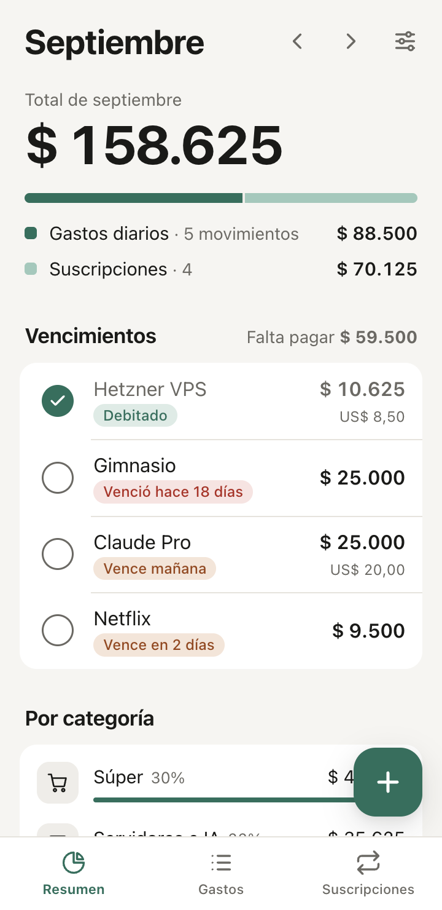
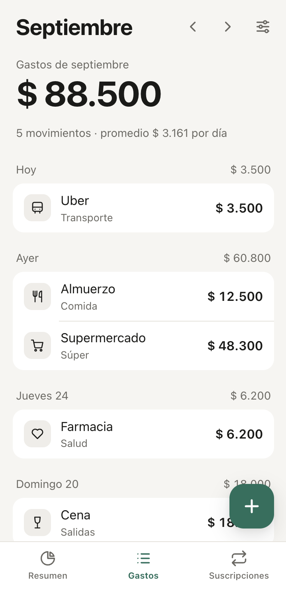
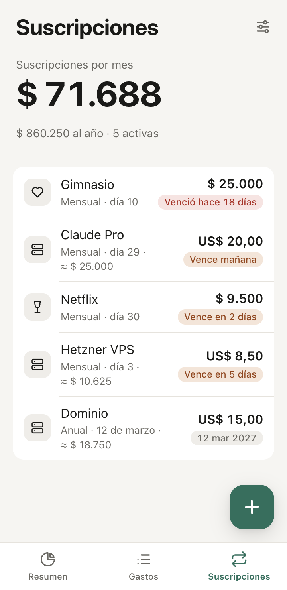
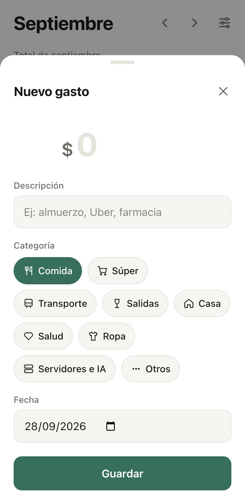

# Gastos

Experimento para medir la capacidad *one-shot* de **Claude Opus 5.5** (Claude Code): con un solo pedido, sin especificación previa ni código base, ¿qué tan cerca de algo usable queda?

El pedido fue una app mínima de uso personal para anotar gastos diarios y suscripciones, ver el total del mes y los vencimientos, y usarla desde el celular como PWA. Con ese primer pedido salió una app funcional. Después hubo iteraciones cortas: una categoría nueva, Docker, una auditoría de UX y la migración a TypeScript. No escribí código a mano.

<p>
  
  
  
  
</p>

## Qué hace

- Gastos diarios por categoría, agrupados por día.
- Suscripciones mensuales o anuales, en pesos o dólares, con vencimientos y débito automático.
- Total del mes y desglose por categoría.
- Funciona offline. Los datos quedan en el dispositivo (`localStorage`) y se pueden exportar o importar como JSON.

## Stack

TypeScript estricto, sin frameworks ni dependencias en runtime. `src/lib.ts` tiene la lógica pura y `src/app.ts` la interfaz; `src/sw.ts` es el service worker. Se sirve con nginx.

## Pruebas

```bash
npm run check   # typecheck (tsc strict) + tests unitarios de src/lib.ts
```

El build de Docker corre `npm run check`, así que un error de tipos o un test roto frena el deploy. Los flujos de interfaz se probaron a mano en Chrome, en celular y escritorio y en tema claro y oscuro.

## Correr

```bash
npm install
npm start                            # build + servidor en http://127.0.0.1:8765
docker build -t gastos . && docker run -p 8080:80 gastos
```

En Coolify: build pack *Dockerfile*, puerto `80`. Para instalarla como PWA hace falta HTTPS.

## Licencia

MIT
