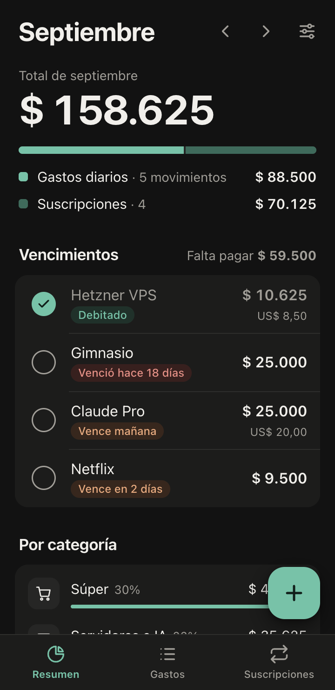

# Gastos

App web personal para anotar gastos diarios, llevar las suscripciones y ver cuánto se va por mes. Se instala en el celular como PWA, funciona sin conexión y guarda todo en el dispositivo. No tiene backend ni cuentas.

<p>
  
  
  
</p>
<p>
  
  
</p>

<sub>Capturas con datos de ejemplo.</sub>

## Por qué existe

Por dos motivos.

1. Quería algo mínimo para mí: abrir, anotar un gasto en cinco segundos y saber cuánto llevo en el mes y qué vence. Las apps de finanzas que probé piden cuenta, conectan bancos o tienen diez pantallas.
2. Fue un experimento para medir la capacidad *one-shot* de **Claude Opus 5.5** (Claude Code). Con un solo pedido, sin especificación previa ni código base, ¿qué tan cerca de algo usable queda?

## Cómo se hizo

Todo en una sola sesión de Claude Code, con carpeta vacía al inicio. Estos fueron los pedidos, textuales y en orden:

| # | Pedido | Resultado |
|---|--------|-----------|
| 1 | *"quiero una app usable en el celu o web, adaptativa usable facil. PWA. Muy simple, entro y cargo gastos de suscripciones. Puedo cargar gastos diarios, me va diciendo el total por mes que tengo, vencimientos. En fin, un aapp de finanzas pero quiero que sea minimal usable por mi solamente"* | La app completa, con gastos, suscripciones, totales, vencimientos, PWA offline y backup. |
| 2 | *"en categorias quiero alguna para mis servidores VPS IA en general"* | Categoría "Servidores e IA", que también se aplica a las suscripciones. |
| 3 | *"dejala lista para que la suba a mi coolify con docker"* | Dockerfile con nginx y healthcheck. |
| 4 | *"hacele una auditoria de UX y mejorala lo maximo posible..."* | Auditoría y rediseño de los flujos (ver abajo). |
| 5 | *"hace le repo publico, documentalo bien..."* | Este README, las capturas y el repo. |

Con el primer pedido ya salió algo funcional, y el modelo lo probó en el navegador antes de darlo por terminado. Los pedidos siguientes son iteraciones normales, no correcciones de algo roto. Yo no escribí ni edité código.

## Qué hace

- **Resumen del mes:** total (gastos + suscripciones), la proporción entre ambos, vencimientos con estado (pagado, vence en N días, vencido), desglose por categoría y últimos movimientos.
- **Gastos diarios:** carga rápida, con el monto primero y el teclado numérico ya abierto. Sugiere descripciones anteriores y, al elegir una, pone su categoría. Se agrupan por día.
- **Suscripciones:** mensuales o anuales, en pesos o dólares (con cotización configurable) y con débito automático opcional. Se pueden pausar sin perder el historial.
- **Meses:** flechas, deslizar con el dedo o tocar "Hoy" para volver al mes actual.
- **Datos:** `localStorage` en el dispositivo, con exportar e importar un JSON como backup. Eliminar se puede deshacer.
- Tema claro y oscuro según el sistema, pensada para celular y usable en escritorio.

## Auditoría de UX (pedido 4)

Problemas que el modelo encontró en su propia primera versión y corrigió:

- Enter en un formulario activaba el botón de cerrar y se perdía lo cargado.
- Eliminar no pedía confirmación ni permitía deshacer.
- En iOS el teclado no se abría al tocar "+", porque el foco se daba con un `setTimeout`.
- Los errores usaban las burbujas nativas y `alert()`. Ahora se muestran junto al campo.
- Una suscripción recién creada aparecía como "vencida" en meses pasados. Se agregaron `since` y `until`.
- Comparaba el mes en curso (parcial) contra el anterior (completo) con un porcentaje engañoso. Se quitó.
- Los íconos eran emoji y glifos Unicode. Se reemplazaron por un set SVG propio.
- Había áreas táctiles de menos de 44px y un contraste de 4.4:1 en el texto secundario.

## Pruebas

No hay tests automatizados: son unas 600 líneas de JS sin dependencias y el riesgo está en la interacción, no en la lógica. Esto se verificó durante la sesión:

- **Navegador (Chrome, vía extensión):** a 390px y en escritorio, en tema claro y oscuro. Se recorrió cada flujo: primer uso, alta, edición y borrado con deshacer (gastos y suscripciones), validaciones, Enter para guardar, cambio de mes, pagado y débito automático, cotización del dólar, backup e importación. Consola sin errores.
- **Parseo de montos:** `3.500`, `1.234,50`, `8,5` y `$ 25.000` se interpretan como se espera en formato argentino.
- **Docker:** build, healthcheck `healthy`, tipos MIME correctos (incluido `manifest.webmanifest`), `no-cache` en `index.html`/`sw.js` y fallback a `index.html` en rutas desconocidas.
- **Detector de diseño** (skill *impeccable*): sin hallazgos.

## Correr

Local, sin build:

```bash
python3 -m http.server 8765 --bind 127.0.0.1 --directory public
```

Docker:

```bash
docker build -t gastos .
docker run -p 8080:80 gastos
```

En **Coolify**: nuevo recurso desde este repo con el build pack *Dockerfile*, puerto `80` y un dominio. Hace falta HTTPS para instalar la PWA. Después, en el celular: Safari → Compartir → *Agregar a inicio*, o Chrome → *Instalar app*.

## Estructura

```
public/
  index.html            shell, íconos SVG
  styles.css            tokens claro/oscuro, componentes
  app.js                estado, vistas, formularios
  sw.js                 service worker (network-first, cache offline)
  manifest.webmanifest
  icons/
Dockerfile, nginx.conf  imagen de producción
```

Al publicar cambios hay que subir `VERSION` en `public/sw.js`.

## Limitaciones conocidas

- Sin sincronización: cada dispositivo tiene sus propios datos (se pasan con exportar e importar).
- Las suscripciones en dólares de meses pasados se convierten con la cotización actual.
- Una sola moneda de gasto diario (pesos).

## Licencia

MIT
